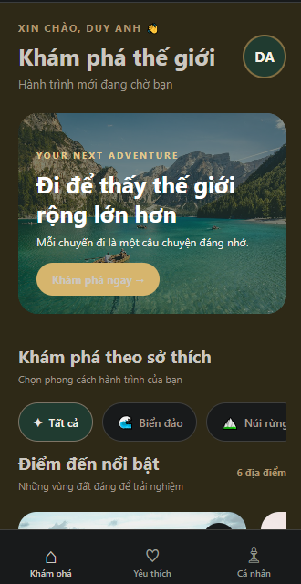
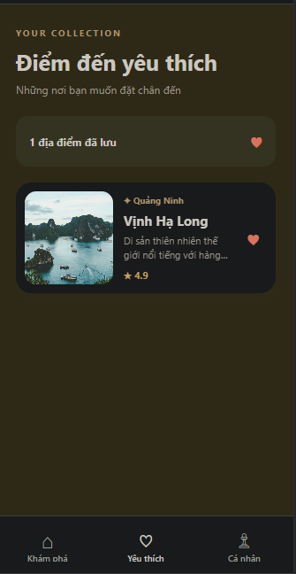
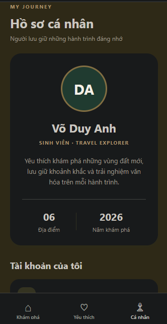

## 1. Link ứng dụng từ Expo

**Tên bài nộp:** TravellingApp

**Link Expo:** https://snack.expo.dev/@voduyanh/travellingapp

## 2. Các dòng code và hình ảnh sự thay đổi giao diện của các thành phần trong component và các component

### 2.1. Component TravelHeader

**Code:**

```jsx
<Text style={styles.greeting}>
  XIN CHÀO, DUY ANH 👋
</Text>
<Text style={styles.title}>
  Khám phá thế giới
</Text>
<Text style={styles.subtitle}>
  Hành trình mới đang chờ bạn
</Text>
```

**Hình ảnh giao diện:**



### 2.2. Component DestinationCard

**Code:**

```jsx
<Image
  source={{ uri: item.image }}
  style={styles.image}
/>
<Text style={styles.name}>{item.name}</Text>
<Text style={styles.description}>
  {item.description}
</Text>
```

**Hình ảnh giao diện:**


### 2.3. Component CategoryList

**Code:**

```jsx
{categories.map((item) => (
  <TouchableOpacity
    key={item.id}
    onPress={() => onSelectCategory(item.id)}
  >
    <Text>{item.icon} {item.name}</Text>
  </TouchableOpacity>
))}
```

**Hình ảnh giao diện:**


### 2.4. Component FavoriteCard

**Code:**

```jsx
<Text style={styles.name}>{item.name}</Text>

<TouchableOpacity onPress={onRemove}>
  <Text style={styles.removeText}>♥</Text>
</TouchableOpacity>
```

**Hình ảnh giao diện:**



### 2.5. Component ProfileInfo

**Code:**

```jsx
<Text style={styles.name}>Võ Duy Anh</Text>
<Text style={styles.role}>
  SINH VIÊN · TRAVEL EXPLORER
</Text>
```

**Hình ảnh giao diện:**

